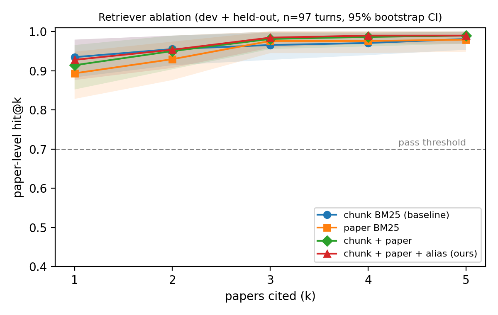

# A3 — Course TA-Bot: Conversational RAG with Memory

**Team:** [Name 1], [Name 2]  ·  **Code:** `ta_bot.py`  ·  **Model:** [model used on PACE-ICE]

## 1. System overview

Each `chat()` turn runs five steps:

1. **Memory write.** Extract durable facts the user states about themselves, filter them, and store them per `user_id` (§3).
2. **Recall intent.** Questions such as "do you remember…" or "what's my name?" are answered from the memory store with no retrieval and no citations.
3. **Query building.** We use the message as the query. In a multi-turn session, when the message depends on earlier turns (pronouns, "that approach", very short follow-ups), we add an LLM rewrite into a standalone query and a down-weighted history query made from the previous query plus the message. A rewrite is discarded if it is longer than 40 words or shares no content words with the conversation. Explicit topic switches ("let me switch topics") skip history.
4. **Retrieval.** Weighted reciprocal-rank fusion over three paper rankers:
   - BM25 over the kit's 400-token chunks (FTS5, porter stemming, title-boosted), using our `retrieval.Retriever`, which keeps each paper's best chunk;
   - BM25 over each paper's title (weight 4) and abstract (weight 1);
   - an alias matcher. It maps names a student would use to the one paper they identify. The names come automatically from title prefixes ("ColBERT:"), "we propose X" in abstracts ("vLLM", "PagedAttention"), and title initials ("Dense Passage Retrieval" → DPR). No paper ids are hard-coded.

   We cite the top papers whose fused score is at least 0.6× the best score, up to 3. Back-references ("all three strategies we discussed") also cite the top paper of each earlier turn they point to.
5. **Generation.** The prompt holds numbered context (title, abstract, and the 2 best-matching chunks per cited paper), the last 3 turns, and the user's stored facts. The model is told to cite as [n] and to say when the context does not answer the question. We append a deterministic "Sources:" line. Temperature 0 and a fixed seed are used, and every ranking breaks ties by `paper_id`, so runs are reproducible. Two runs of our held-out script gave byte-identical output.

## 2. Ablation (R4): which retrievers are fused

**Axis.** We vary the retriever set and keep everything else fixed:

- (a) chunk BM25 only (the kit baseline);
- (b) paper-level title+abstract BM25 only;
- (c) a + b;
- (d) a + b + alias (submitted).

**Metric.** Paper-level hit@k with exactly k papers cited, k = 1…5. We score every turn of the dev set (20 turns) and of a held-out set we wrote ourselves (77 turns: 30 questions that name the paper, 30 that do not, and 6 multi-turn dialogues). The held-out set was not used for tuning. LLM rewriting is off in all variants, so only the retriever changes. 95% CIs come from 2,000 bootstrap resamples over turns. To reproduce: `python eval_extra/ablation.py`.

| Variant | hit@1 [95% CI] | hit@3 [95% CI] |
|---|---|---|
| chunk BM25 (baseline) | 0.935 [0.883, 0.979] | 0.966 [0.928, 0.997] |
| paper BM25 | 0.893 [0.828, 0.948] | 0.976 [0.945, 1.000] |
| chunk + paper | 0.914 [0.852, 0.966] | 0.981 [0.955, 1.000] |
| chunk + paper + alias (ours) | 0.928 [0.876, 0.979] | 0.985 [0.959, 1.000] |

**Interpretation.**

- **Fusion is not a measurable win on hit-rate.** Every variant clears the 0.70 bar by a wide margin. The full system is slightly ahead at k=3 (0.985 vs 0.966) and level at k=1, but every CI overlaps, so the data cannot separate them. We do not claim fusion helps.
- **Why the metric saturates.** The corpus is small (108 papers), and student questions usually contain the paper's own vocabulary ("late interaction", "PagedAttention"), so chunk BM25 already ranks the right paper first in about 93% of turns.
- **The alias matcher adds little on this data.** Whenever a question names a paper, the name usually also appears in that paper's chunks.
- **Query preprocessing in the chunk retriever does not matter here either.** Stopword removal and AND-before-OR matching (the options in `retrieval.py`) all give 0.98 overall held-out hit-rate in the full system; only top-1 moves, within noise. We kept the defaults rather than tune on the held-out set.
- **Paper-only BM25 is the weakest at k=1.** Its index (title and abstract) is about 1% of the text, so questions about specific details ("how does it handle rare words") have little to match.
- **Where the system still fails.** The remaining errors are paraphrases with no lexical anchor. Example: "a small draft model proposes tokens that the large model verifies" (speculative decoding) retrieves Medusa instead. Dense retrieval or LLM rewriting is the natural fix.
- **Threats to validity.** The questions were written by us (and an AI assistant), which probably biases them toward lexical overlap. n = 97 is small. Hit-rate does not measure answer quality.
- **Follow-up.** Because hit-rate saturates, the more informative ablation is LLM query rewriting on vs. off, scored by answer quality on the real endpoint: `run_heldout.py --config '{"rewrite":"off"}'`. [Fill in if you run it on PACE-ICE.]

## 3. Memory design (R3)

**What we store.** Six slots of durable, course-relevant facts: name, project/thesis topic, research interests, academic background, learning goals, and answer-style preferences. Each fact is the user's own words copied verbatim, e.g. `Project: conversational query rewriting for multi-turn RAG systems`. `name` and `project` hold a single value, so "actually, my project is X" replaces the old value. The other slots hold several values, are de-duplicated, and the store is capped at 20 facts. Memory is keyed by `user_id` only, and conversation history is keyed by `session_id`. A new user starts with nothing, and a new session starts with no history but keeps memory.

**When we write.** On every user turn, before answering:

1. Regex rules match first-person statements ("my name is", "I'm writing my project on", "I'm interested in", "I prefer").
2. Optionally, the LLM is asked for facts. To store a fact, the LLM must quote it from the message, and we keep it only if the quote is a literal substring of what the user typed. This stops the model from storing anything the user did not say, including paraphrased or hallucinated facts.

Stored facts are added to later system prompts with the instruction "use only to tailor the answer; do not recite unprompted". Recall questions are answered from the store. If the model paraphrases, we append the stored facts verbatim so recall does not depend on the model's wording.

**What we refuse to store, and why.**

- **Credentials and identifiers:** passwords, API keys, SSNs, student IDs, card or account numbers, long digit runs.
- **Contact data:** emails, phone numbers, home addresses, dates of birth.
- **Special-category data:** health or disability, religion, sexuality, politics, immigration status, finances, grades or disciplinary records.
- **Information about third parties** ("my roommate…").
- **Anything said under an explicit opt-out** ("don't remember this", "off the record", "hypothetically", "just for today").
- **"Forget my X"** deletes matching facts, and "forget everything" clears the store.

The reasoning is data minimisation. A TA needs your topic and preferences to help you. It never needs your ID or diagnosis, and storing such data creates FERPA and privacy liability with no benefit to answers. Third parties cannot consent. Students should be able to retract what they said. The filter is applied to the extracted value and its label. Facts are atomic, so a sensitive clause drops only that fact: "My name is Sam and my SSN is …" keeps only the name.

We deliberately over-refuse. A project "on medical QA" is dropped because it matches a health keyword. In our view, losing a harmless fact is cheaper than keeping a sensitive one.

**Validation.** Dev probes pass 2/2. Our held-out probes pass 13/13: 4 positive, 8 negative (ID, password, diagnosis, email, retracted project, opt-out, third party, address) and 1 cross-user isolation probe.

**Limitations.**

- Regex extraction misses unusual phrasings; LLM extraction partly covers this.
- Keyword filters can be evaded and do not understand context.
- Memory lives in the process by default. Setting `memory_path` persists it to JSON. We chose in-process memory so graded runs cannot leak state from one run into the next.

## 4. Results on the real endpoint

[Fill in: `python eval_dev.py --endpoint … --model …` and `python eval_extra/run_heldout.py --endpoint …` on PACE-ICE: hit-rate, memory probes, and a few judged answers. If you find a case where the LLM judge mis-scored an answer, document it with evidence for the bonus.]

## 5. AI-use disclosure

[Edit so this is accurate and complete. Example:] [Teammate] wrote the chunk retriever (`retrieval.py`) and its strategy comparison. We used Claude Code (Anthropic) to implement the rest of `ta_bot.py` (fusion, query handling, memory, generation), to write the held-out evaluation set and the ablation script, and to draft this report. We [describe what you reviewed, changed, and re-ran yourselves]. We verified the results by running the dev self-check and our held-out set ourselves, inspecting misses by hand, and [real-endpoint runs on PACE-ICE]. The held-out questions were AI-written, which is a threat to validity (§2).
